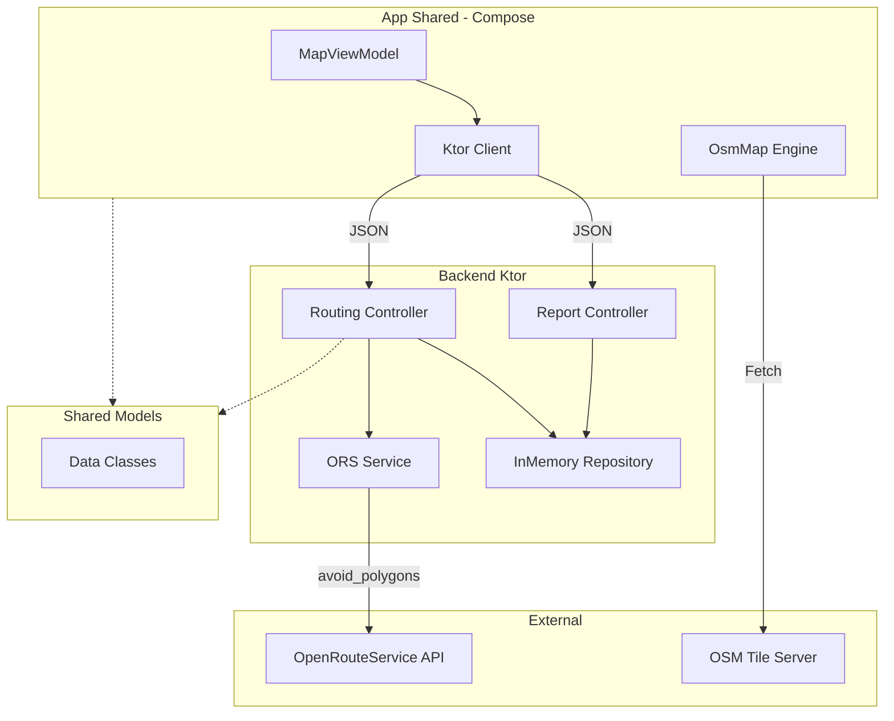

# Exigences (Requirements)

### Présentation
Ce projet vise à créer une application collaborative de navigation pour les personnes à mobilité réduite. L'application permet de signaler des obstacles et de calculer des itinéraires adaptés en contournant ces obstacles via l'API OpenRouteService.

### Objectifs & Portée
L'objectif est de fournir un MVP fonctionnel sur Android, iOS et Web (Wasm) utilisant Compose Multiplatform et un backend Ktor.

**En Scope :**
- Sélection du profil de mobilité (Fauteuil, Béquilles, etc.).
- Affichage d'une carte OSM via un moteur Canvas personnalisé avec tuiles HTML sur WasmJs.
- Signalement d'obstacles (type, description, position).
- Calcul d'itinéraire avec évitement dynamique des obstacles incompatibles.
- Backend agissant comme proxy sécurisé vers OpenRouteService.

**Hors Scope (pour le MVP) :**
- Connexion réelle à Supabase (remplacée par de l'In-Memory pour le moment).
- Authentification des utilisateurs.
- Navigation pas-à-pas en temps réel (guidage vocal).

# Conception Technique (Technical Design)

### Architecture Globale
L'application suit une architecture client-serveur classique avec partage de code via Kotlin Multiplatform.



### Détails Techniques

#### 1. Modèles de Données (`core`)
- `MobilityProfile`: Enum définissant les capacités et besoins (WHEELCHAIR, CRUTCHES, VISUAL_IMPAIRMENT).
- `Report`: Structure contenant les informations sur l'obstacle.
- `Location`: Représentation simple `(lat, lon)`.

#### 2. Backend (`server`)
- **Évitement d'obstacles** : Le serveur récupère les obstacles du repository, filtre ceux qui sont incompatibles avec le profil (ex: des marches pour un fauteuil) et les envoie à l'API ORS sous forme de petits polygones (carrés de quelques mètres autour du point).
- **Sécurité** : La clé API `ORS_API_KEY` reste côté serveur.

#### 3. Frontend (`app/shared`)
- **Moteur de Carte WasmJs** : Tuiles OSM rendues via des `` HTML positionnés au-dessus du Canvas Compose (z-index: 2) avec `pointer-events: none` pour que les clics traversent vers le Canvas. Le Canvas reste transparent et gère les interactions (zoom, pan, tap). La UI Compose (dialogs, boutons) est dessinée dans le Canvas et reste cliquable.
- **Conversion de Coordonnées** : Implémentation de la projection de Mercator pour transformer `(lat, lon)` en positions `(x, y)` sur le Canvas selon le niveau de zoom.

### Modèles de Données (Pseudocode)

```kotlin
@Serializable
data class Report(
    val id: String,
    val type: ReportType,
    val description: String,
    val location: Location
)

@Serializable
data class RouteRequest(
    val start: Location,
    val end: Location,
    val profile: MobilityProfile
)
```

### Risques & Atténuations
- **Performance du Canvas** : Le rendu de nombreuses tuiles peut être gourmand. Solution : Cache mémoire des tuiles et rendu limité à la zone visible.
- **Limites d'API ORS** : Le paramètre `avoid_polygons` a des limites. Solution : Ne filtrer que les obstacles les plus proches de l'itinéraire vol d'oiseau si nécessaire.
- **Canvas opaque sur WasmJs** : Le Canvas Skiko/WebGL a un fond blanc opaque qu'on ne peut pas rendre transparent. Solution : Tuiles HTML au premier plan avec `pointer-events: none`.

# Tests (Testing)

### Approche de Validation
La validation sera effectuée de manière incrémentale à l'aide de builds et de logs.

### Scénarios Clés
1. **Carte visible** : Vérifier que les tuiles OSM s'affichent correctement sur Paris au chargement.
2. **Interactions** : Zoomer, dézoomer et déplacer la carte.
3. **Ajout d'un rapport** : Vérifier qu'un clic sur la carte crée bien un rapport via le serveur et qu'il réapparaît après rafraîchissement.
4. **Itinéraire direct** : Vérifier le calcul d'un point A à un point B sans obstacle.
5. **Itinéraire avec évitement** : Placer un obstacle de type "Escaliers" sur le trajet direct, sélectionner le profil "Fauteuil roulant" et vérifier que l'itinéraire proposé fait un détour.

### Cas Limites
- **Hors ligne** : Comportement gracieux si les tuiles ne peuvent pas être téléchargées.
- **Coordonnées invalides** : Gestion des erreurs sur les points de départ/arrivée hors zone.

# Delivery Steps

### ✓ Step 1: Mise en place des modèles Core et des dépendances
Mettre en place les bases du projet pour la communication client-serveur.

- Mettre à jour `libs.versions.toml` avec les dépendances `kotlinx-serialization`, `ktor` (client & serveur), et `coroutines`.
- Configurer les plugins de sérialisation dans les fichiers `module.yaml`.
- Définir les modèles de données partagés dans `core/src` : `MobilityProfile`, `ReportType`, `Location`, `Report`, `RouteRequest`, `RouteResponse`.
- Effectuer un build de vérification.

### ✓ Step 2: Backend : Gestion des signalements et Schéma SQL
Implémenter la gestion des signalements sur le backend.

- Créer l'interface `ReportRepository` et son implémentation `InMemoryReportRepository` dans le module `server`.
- Définir les endpoints Ktor `GET /api/reports` et `POST /api/reports`.
- Générer le fichier `schema.sql` correspondant aux modèles pour Supabase.
- Ajouter la gestion des erreurs et la sérialisation JSON sur le serveur.
- Effectuer un build de vérification.

### ✓ Step 3: Backend : Routage avec évitement d'obstacles (ORS)
Connecter le backend à l'API OpenRouteService pour le calcul d'itinéraire intelligent.

- Implémenter `OpenRouteServiceService` pour appeler l'API externe.
- Ajouter la logique de filtrage des obstacles : transformer les signalements incompatibles en polygones d'évitement (`avoid_polygons`).
- Créer l'endpoint `POST /api/route` qui retourne la liste de coordonnées.
- Configurer la lecture de `ORS_API_KEY` depuis les variables d'environnement.
- Effectuer un build de vérification.

### ✓ Step 4: Frontend : Moteur de carte personnalisé via Canvas
Créer le moteur de rendu de carte multiplateforme.

- Implémenter un composant `OsmMap` utilisant Compose `Canvas`.
- Gérer le téléchargement et le cache (mémoire) des tuiles OpenStreetMap.
- Implémenter le système de coordonnées pour convertir Lat/Lng en pixels sur le Canvas (projection Mercator).
- Ajouter le support du zoom et du déplacement (pan).
- Effectuer un build de vérification sur Android et Wasm.

### ✓ Step 5: Frontend : UI, ViewModel et Intégration Finale
Finaliser l'application avec les fonctionnalités métier.

- Créer le `MapViewModel` pour orchestrer les données (profil, rapports, itinéraire).
- Implémenter l'écran de sélection du profil de mobilité.
- Ajouter l'affichage des marqueurs de signalements et du tracé de l'itinéraire sur la carte.
- Implémenter le formulaire d'ajout de signalement (clic sur carte).
- Effectuer une vérification finale du flux complet A -> B.

### ✓ Step 6: Tuiles OSM réelles et CORS
Connecter l'application aux API OpenStreetMap et OpenRouteService pour afficher la carte réelle et envoyer/récevoir les signalements.

- Implémenter `HtmlTileLayer` pour WasmJs : affichage des tuiles OSM via des éléments HTML ``.
- Créer l'interface `TileLayerInterface` avec implémentations `expect/actual` par plateforme.
- Mettre à jour `OsmMap` pour utiliser le tile layer sur WasmJs et les placeholders gris sur les autres plateformes.
- Ajouter le support CORS OPTIONS (preflight) sur le serveur Ktor pour les routes `/api/reports` et `/api/route`.
- Mettre à jour `index.html` avec le conteneur `TileLayer`.
- Builds de vérification : shared (wasmJs, android), server (jvm), webApp (wasmJs).

### ✓ Step 7: Correction du rendu de la carte — Tuiles HTML au premier plan
Résoudre le problème du Canvas opaque Skiko sur WasmJs en plaçant les tuiles HTML au-dessus du Canvas avec `pointer-events: none`.

- Mettre à jour `styles.css` : `#TileLayer` en `z-index: 2` avec `pointer-events: none`, `#ComposeTarget` en `z-index: 1`.
- Supprimer les tentatives de transparence CSS sur le Canvas (`#ComposeTarget canvas { background: transparent }`) qui ne fonctionnent pas sur Skiko/WebGL.
- S'assurer que `HtmlTileLayer.wasmJs.kt` positionne les tuiles correctement avec la même projection Mercator que le Canvas.
- Vérifier que les interactions (zoom, pan, tap) traversent les tuiles HTML pour atteindre le Canvas Compose.
- Vérifier que la UI Compose (dialogs, boutons) reste cliquable car elle est dessinée dans le Canvas et capture les événements avant qu'ils ne traversent.
- Build de vérification : shared (wasmJs, android), webApp (wasmJs).