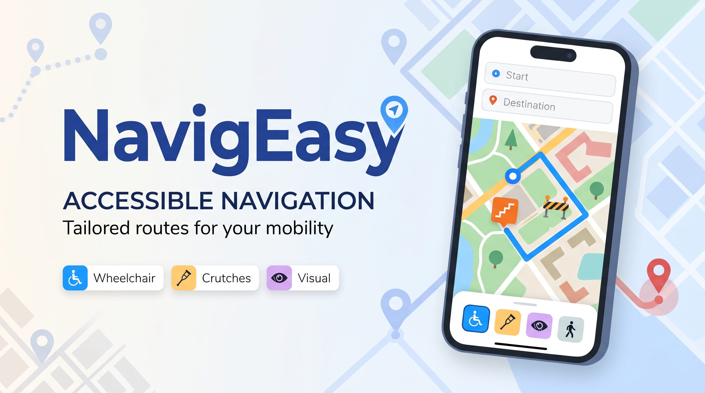

# NavigEasy

> Accessible navigation for everyone — built at LauzHack.


[](https://kotlinlang.org)
[](https://kotl.in/wasm)
[](https://kotlinlang.org/compose-multiplatform/)
[](https://ktor.io/)
[](https://www.openstreetmap.org/)
[](https://lauzhack.fr)

## Overview

NavigEasy is an accessible navigation application designed for people with reduced mobility (wheelchair, crutches) and visual impairments. Unlike standard navigation apps that treat all pedestrians the same, NavigEasy dynamically adjusts routes based on the user's mobility profile and community-reported obstacles.

## The Problem

Standard navigation apps assume a level playing field. They route a wheelchair user past stairs, guide someone with visual impairments across poorly lit crossings, and ignore temporary obstacles like sidewalk construction. For millions of people with disabilities, this means routes that are technically shortest but practically unusable.

## The Solution

NavigEasy solves this by combining three layers of awareness:

1. **Mobility Profiles** — each user selects a profile (wheelchair, crutches, visual impairment, or standard) that determines which obstacles matter.
2. **OpenStreetMap Data** — physical barriers from OSM (stairs, kerbs, cobblestones, missing tactile paving) are fetched via the Overpass API and rendered on the map.
3. **Community Reports** — users can report temporary obstacles (construction, flooding, blocked paths). These reports are automatically converted into avoidance polygons that influence routing via OpenRouteService.

The result is a route that respects the user's actual physical constraints, not just the graph distance.

## Key Features

- **Mobility Profiles** — Four built-in profiles: Wheelchair, Crutches, Visual Impairment, and Standard. Each profile maps to an OpenRouteService routing profile and a set of incompatible obstacle types.
- **Dynamic Obstacle Avoidance** — Community-reported obstacles incompatible with the selected profile are automatically converted into avoidance polygons sent to OpenRouteService. The routing engine steers clear of these areas.
- **OSM-Based Obstacle Detection** — Physical barriers from OpenStreetMap (stairs, high kerbs, revolving doors, missing tactile indicators, silent crossings) are queried via the Overpass API and displayed as color-coded markers on the map.
- **Offline GeoJSON Fallback** — A bundled GeoJSON file provides a stable set of known obstacles for the demo area, ensuring the map works even when the Overpass API is unavailable.
- **Community Reporting System** — Users can submit obstacle reports with location, category, severity, and affected disability types. Reports support a voting mechanism: once a report reaches 5 resolution votes, it is automatically marked as resolved.
- **Address Search** — Integrated Nominatim search for finding start and destination addresses.
- **Custom Map Rendering** — A Compose Canvas-based map with Mercator projection, tile caching, pinch-to-zoom, pan gestures, and route visualization.

## Technical Architecture

```
┌─────────────────────────────────────────────────────────┐
│                    Web Frontend (WasmJs)                │
│  Compose Multiplatform UI  →  OsmMap (Canvas)          │
│  NavigationApp  →  MapViewModel  →  Ktor Client        │
└──────────────────────────┬──────────────────────────────┘
                           │ HTTP / JSON
┌──────────────────────────▼──────────────────────────────┐
│              Ktor Server (Netty, port 8081)             │
│                                                         │
│  /api/route      → OpenRouteServiceService              │
│  /api/reports    → SupabaseReportRepository             │
│  /api/overpass   → OverpassService                      │
│  /api/nominatim  → NominatimService                     │
└────────┬──────────────┬──────────────┬──────────────────┘
         │              │              │
    ┌────▼────┐   ┌─────▼────┐  ┌─────▼────┐
    │  ORS    │   │ Supabase │  │  Nominatim│
    │  API    │   │  (Postg  │  │  / Over-  │
    │         │   │  res)    │  │  pass API │
    └─────────┘   └──────────┘  └──────────┘
```

### Modules

| Module | Description |
|--------|-------------|
| `app/shared` | Shared Compose UI, ViewModels, map rendering (`OsmMap`, `MercatorProjection`), and platform-specific implementations (Android, iOS, WasmJs) |
| `app/webApp` | WasmJs entry point — launches the Compose viewport in the browser |
| `app/androidApp` | Android application target |
| `app/iosApp` | iOS application target |
| `core` | Shared data models: `MobilityProfile`, `Report`, `ReportType`, `Severity`, `Location`, `OsmFeature`, `RouteRequest` |
| `server` | Ktor backend with Netty engine exposing REST endpoints for routing, reports, Overpass queries, and Nominatim search |

### Routing Pipeline

1. The user selects a **mobility profile** and enters a start/destination.
2. The server fetches all active community reports and filters those incompatible with the selected profile.
3. Each incompatible report is converted into an **avoidance polygon** (a bounding box around the obstacle).
4. The request — including the ORS profile and avoidance polygons — is sent to **OpenRouteService**.
5. The returned GeoJSON route is parsed and rendered on the Compose Canvas as a polyline overlay.

### Map Rendering

The map is built entirely with Compose `Canvas` primitives:

- **Tile Layer** — Standard 256px OSM tiles fetched and cached (`TileCache`). Platform-specific tile loading via `expect/actual` (Android: `BitmapFactory`, iOS: `CGImage`, WasmJs: HTML `` elements).
- **Mercator Projection** — Custom `MercatorProjection` utility converts lat/lon to pixel coordinates and back.
- **Overlays** — Route polylines, obstacle markers (color-coded by type), user location, and avoidance polygon indicators are drawn on top of the tile layer.
- **Gestures** — Pinch-to-zoom and drag-to-pan via Compose pointer input.

## Running Locally

### Prerequisites

- **JDK 17+**
- **Kotlin Toolchain** (bootstrapped automatically via the `./kotlin` wrapper script)

### Environment Variables

The server requires the following environment variables:

```bash
# OpenRouteService API key (required for routing)
export ORS_API_KEY="your-ors-api-key-here"

# Supabase project URL (required for community reports)
export SUPABASE_URL="https://your-ref.supabase.co"

# Supabase anon API key (required for community reports)
export SUPABASE_ANON_KEY="sb_publishable_..."
```

To obtain an ORS API key, sign up at [openrouteservice.org](https://openrouteservice.org/).

### Building and Running

The project uses the [Kotlin Toolchain](https://kotlin-toolchain.org/dev/) for builds. The `./kotlin` script in the project root bootstraps automatically on first use.

**Build the entire project:**

```bash
./kotlin build
```

**Run the web application (WasmJs):**

```bash
./kotlin run -m webApp
```

The web app will be served at `http://localhost:8080` by default.

**Run the Ktor server:**

```bash
./kotlin run -m server
```

The server starts on `http://localhost:8081`.

**Run other targets:**

```bash
./kotlin run -m androidApp    # Android
./kotlin run -m iosApp        # iOS (requires macOS + Xcode)
```

**Run tests:**

```bash
./kotlin test                  # All modules
./kotlin test -m server        # Server only
```

### Supabase Setup

The `schema.sql` file in the project root contains the full database schema for the `reports` table, including Row Level Security (RLS) policies. Run it against your Supabase project's SQL editor to set up the reports table.

## API Endpoints

| Method | Endpoint | Description |
|--------|----------|-------------|
| `POST` | `/api/route` | Calculate a route with obstacle avoidance |
| `GET` | `/api/reports` | List all community reports |
| `POST` | `/api/reports` | Submit a new obstacle report |
| `GET` | `/api/reports/{id}` | Get a single report by ID |
| `PATCH` | `/api/reports/{id}` | Vote to resolve a report |
| `POST` | `/api/overpass` | Query OpenStreetMap data via Overpass API |
| `POST` | `/api/nominatim` | Search addresses via Nominatim |

## Future Improvements

- **User Authentication** — Add authentication so users can save their mobility profile and preferences, avoiding the need to reselect them on every visit.
- **Contributor Reputation** — A reputation system for active community members: users who frequently submit and verify obstacle reports earn a trusted reporter status, giving their contributions higher visibility and weight in the resolution voting mechanism.


## Team

| Name | GitHub |
|------|--------|
| Mathis Ducrocq | [@MathisDu](https://github.com/username) |
| Lea Jelic | [@leajelic](https://github.com/username) |
| Olivia Chagot | [@oliviachgt](https://github.com/username) |

## Acknowledgments

- [OpenRouteService](https://openrouteservice.org/) for accessible routing profiles
- [OpenStreetMap](https://www.openstreetmap.org/) and the [Overpass API](https://overpass-api.de/) for map data
- [Nominatim](https://nominatim.org/) for geocoding
- [Supabase](https://supabase.com/) for the backend database
- [Kotlin Multiplatform](https://kotlinlang.org/) and [Compose Multiplatform](https://kotlinlang.org/compose-multiplatform/) for the cross-platform framework
- [Ktor](https://ktor.io/) for the server framework
- LauzHack organizers and mentors

---

Built with Kotlin at LauzHack 2026.
