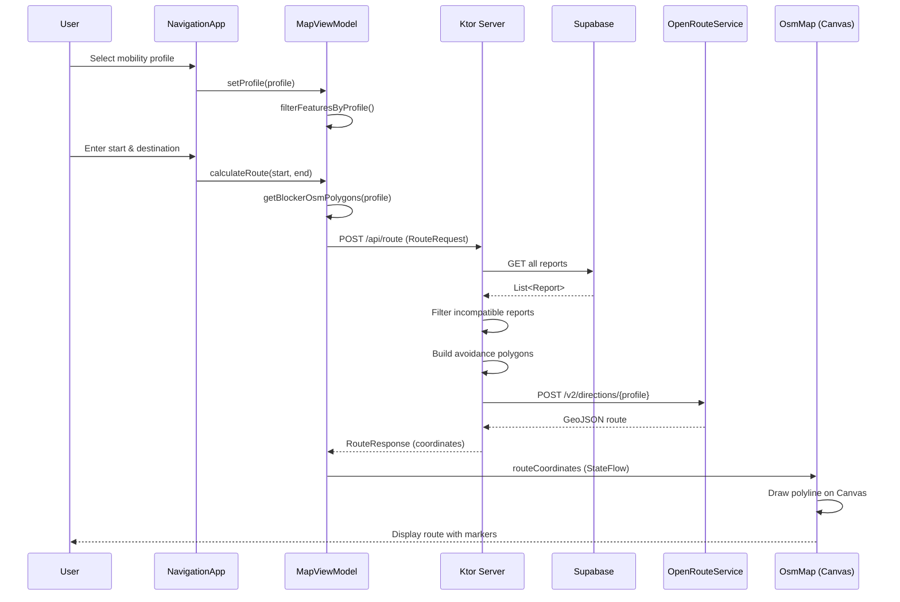

# NavigEasy

> Accessible navigation for everyone — built at LauzHack.


[](https://kotlinlang.org)
[](https://kotl.in/wasm)
[](https://kotlinlang.org/compose-multiplatform/)
[](https://ktor.io/)
[](https://www.openstreetmap.org/)
[](https://lauzhack.fr)

## Overview

NavigEasy is an accessible navigation application that dynamically routes around physical and community-reported obstacles based on the user's mobility profile. It supports **wheelchair**, **crutches**, and **visual impairment** profiles, each of which determines which obstacles block the route and which are displayed as informational warnings.

Built with Kotlin Multiplatform, Compose Multiplatform, and WebAssembly, it runs as a web application and can target Android and iOS.

## The Problem

Standard navigation apps treat all pedestrians identically. A wheelchair user is routed past stairs. A person with visual impairments is guided across crossings without tactile paving or audio signals. Temporary obstacles — sidewalk construction, flooding, blocked paths — are invisible to the routing engine. The result is a route that is mathematically shortest but physically unusable.

## The Solution

NavigEasy layers three sources of accessibility data on top of standard routing:

1. **Mobility Profiles** — the user selects a profile that defines which obstacle types are impassable versus informational.
2. **OpenStreetMap Data** — physical barriers (stairs, kerbs, bad surfaces, missing tactile paving) are loaded from an offline GeoJSON file derived from OSM data and rendered as color-coded markers.
3. **Community Reports** — users submit temporary obstacles that are automatically converted into avoidance polygons sent to the routing engine.

The routing engine (OpenRouteService) receives avoidance polygons for hard blockers and returns a route that steers clear of them. Soft warnings are bypassed in the routing request but drawn on the map so the user is informed.

## Architectural Decisions

### Why Kotlin Multiplatform & Compose Multiplatform

The project targets Web (WasmJs), Android, and iOS from a single codebase. KMP with Compose Multiplatform gives us:

- **Maximum UI sharing** — the entire Compose UI (`NavigationApp`, `OsmMap`, `MapViewModel`) lives in `app/shared` and compiles to all three targets without platform-specific UI code.
- **Shared business logic** — data models (`MobilityProfile`, `Report`, `OsmFeature`), routing logic, and GeoJSON parsing are in `core` and `app/shared`, compiled once and reused across targets.
- **Platform-specific interop where needed** — tile loading, geolocation, and HTTP client differences are isolated in `src@android`, `src@wasmJs`, and `src@iosArm64` folders using Kotlin's `expect/actual` mechanism.

This means a feature or bug fix in the routing logic or map rendering applies to all platforms simultaneously.

### Why a Ktor Backend Server

Rather than calling external APIs (OpenRouteService, Overpass, Nominatim, Supabase) directly from the client, all requests go through a Ktor server running on port 8081. This design:

- **Hides API keys** — the `ORS_API_KEY` and `SUPABASE_ANON_KEY` never leave the server.
- **Centralizes obstacle-to-polygon conversion** — the server's `OpenRouteServiceService` fetches community reports from Supabase, filters them by the selected mobility profile, and builds avoidance polygons before forwarding to ORS. The client does not need to know about this logic.
- **Provides a uniform REST interface** — the client talks to one base URL (`http://localhost:8081`) with consistent JSON request/response shapes.

### Routing Limitations & The "Avoid Polygon" Approach

OpenRouteService does not support soft penalties or weighted obstacles. Its `avoid_polygons` option treats every polygon as an absolute wall — the routing engine will not pass through it under any circumstances. This creates a problem: if we send every obstacle (including bad surfaces or missing tactile paving) as an avoidance polygon, the engine produces absurdly long detours around minor issues.

**Our solution is a two-tier system:**

| Tier | What it is | How it's handled | Example |
|------|-----------|-----------------|---------|
| **Hard Blockers** | Physically impassable for the selected profile | Converted to avoidance polygons and sent to ORS | Stairs for wheelchair users |
| **Soft Warnings** | Informational — the route can pass, but the user should be aware | Not sent to ORS; drawn on the Canvas as colored markers | Bad surface for wheelchair, missing tactile paving for visual impairment |

Each hard blocker is converted into a bounding-box polygon with a radius of `0.0005` degrees (approximately 50 meters) around the obstacle's coordinates. The polygon is a closed ring of 5 points forming a square. For manual user-placed avoidance zones, the radius is smaller (`0.0002` degrees, ~20 meters) and the polygon is a 16-point circle approximation, with the longitude radius scaled by `cos(latitude)` to account for Mercator distortion.

The blocker/warning split is defined per profile in `MapViewModel.getBlockerOsmPolygons()`:

- **Wheelchair**: blockers = stairs, barriers, revolving doors, high kerbs, wheelchair-restricted access.
- **Crutches**: blockers = stairs, revolving doors.
- **Visual Impairment**: no blockers (all obstacles are warnings only).
- **Standard**: no blockers, no warnings.

### Why a Custom Canvas Map Instead of a Map SDK

We could have used Leaflet, Mapbox GL JS, or Google Maps. Instead, we built a custom `OsmMap` composable that renders everything on a Compose `Canvas`. Reasons:

- **Total control over obstacle rendering** — every marker (pin-style circles with shadows, color-coded by obstacle type), the route polyline, avoidance polygon overlays, and the user location dot are drawn as Canvas primitives. A third-party SDK would require custom markers or overlays that are harder to style consistently.
- **Offline GeoJSON parsing** — the app loads a bundled GeoJSON file (`obstacles1.geojson`) at startup, parses it into `OsmFeature` objects, and filters them by the selected profile. This entire pipeline runs client-side without any external dependency.
- **No SDK overhead** — for a hackathon demo targeting WasmJs, avoiding the weight of a full map library keeps the initial bundle small and the rendering pipeline simple.
- **Mercator projection from scratch** — `MercatorProjection` converts lat/lon to pixel coordinates and back, handling tile grid calculations, zoom levels (1-19), and viewport fitting.

On WasmJs, map tiles are rendered via HTML `` elements behind a transparent Canvas (the `HtmlTileLayer` approach). On Android and iOS, tiles would be drawn directly on the Canvas using platform-specific bitmap loading (`BitmapFactory` / `CGImage`).

## System Architecture

```
┌─────────────────────────────────────────────────────────────────┐
│                     Client (WasmJs / Android)                   │
│                                                                 │
│  NavigationApp.kt                                                │
│  ├── Profile selection  →  MapViewModel.setProfile()            │
│  ├── Address search     →  MapViewModel.searchAddress*()        │
│  ├── Route request      →  MapViewModel.calculateRoute()        │
│  └── Report submission  →  MapViewModel.addReport()             │
│                                                                 │
│  MapViewModel.kt                                                 │
│  ├── Filters OSM features by profile (blockers vs warnings)     │
│  ├── Builds avoidance polygons for blockers                     │
│  └── Sends RouteRequest to server                               │
│                                                                 │
│  OsmMap.kt (Compose Canvas)                                      │
│  ├── Renders OSM tiles (HTML  on WasmJs)                   │
│  ├── Draws route polyline                                       │
│  ├── Draws obstacle markers (color-coded by ObstacleType)       │
│  ├── Draws report markers                                       │
│  └── Draws avoidance polygon overlays                           │
└────────────────────────────┬────────────────────────────────────┘
                             │  HTTP / JSON
┌────────────────────────────▼────────────────────────────────────┐
│                   Ktor Server (port 8081)                        │
│                                                                  │
│  POST /api/route                                                 │
│  ├── Receives RouteRequest (start, end, profile, avoidPolygons)  │
│  ├── Fetches all reports from Supabase                           │
│  ├── Filters reports incompatible with profile                   │
│  ├── Builds auto avoidance polygons from reports                 │
│  ├── Merges with manual avoid polygons from request              │
│  ├── Forwards to OpenRouteService with avoid_polygons            │
│  └── Returns RouteResponse (coordinates, distance, duration)     │
│                                                                  │
│  POST /api/reports    — Submit a new obstacle report             │
│  GET  /api/reports     — List all reports                        │
│  PATCH /api/reports/:id — Vote to resolve                        │
│  POST /api/overpass    — Query OSM data                          │
│  POST /api/nominatim   — Search addresses                        │
└────────┬───────────────┬──────────────┬─────────────────────────┘
         │               │              │
   ┌─────▼─────┐   ┌─────▼────┐  ┌─────▼────┐
   │ OpenRoute │   │ Supabase │  │ Nominatim│
   │ Service   │   │ (Postg  │  │ / Over-  │
   │ (ORS)     │   │  res)    │  │  pass    │
   └───────────┘   └──────────┘  └─────────┘
```

## Developer Onboarding — Data Flow

When a new developer joins, the most important thing to understand is how a route request flows from the user's profile selection to the rendered polyline on the map.

### Step 1: User selects a mobility profile

In `NavigationApp.kt`, the user picks one of four profiles. The selection is stored in `MapViewModel._selectedProfile` (a `MutableStateFlow<MobilityProfile>`).

Each profile in `MobilityProfile.kt` defines:
- `orsProfile` — the OpenRouteService profile string (e.g., `"wheelchair"`, `"foot-walking"`).
- `incompatibleReportTypes` — a set of `ReportType` values that are blockers for this profile.

### Step 2: ViewModel filters obstacles

`MapViewModel` maintains two obstacle lists:

- `_allOsmFeatures` — all obstacles loaded from the offline GeoJSON file at startup.
- `_filteredOsmFeatures` — derived from `_allOsmFeatures` + `_selectedProfile` via `filterFeaturesByProfile()`. This list determines which markers appear on the Canvas.

When `calculateRoute()` is called, the ViewModel additionally calls `getBlockerOsmPolygons()` to separate **hard blockers** (sent to ORS as avoidance polygons) from **soft warnings** (drawn on the map but not sent to ORS).

### Step 3: Server builds the ORS request

`MapViewModel` sends a `RouteRequest` (containing start, end, profile, and manual avoid polygons) to `POST /api/route`.

On the server, `OpenRouteServiceService.calculateRoute()`:
1. Fetches all active reports from Supabase via `ReportRepository`.
2. Filters reports where `reportType` is in the profile's `incompatibleReportTypes`.
3. Converts each incompatible report into a bounding-box polygon (`0.0005` degree radius).
4. Merges auto-generated polygons with any manual polygons from the request.
5. Builds the GeoJSON body for ORS, using `Polygon` (single) or `MultiPolygon` (multiple) format.
6. Posts to `https://api.openrouteservice.org/v2/directions/{profile}`.

### Step 4: Route is decoded and rendered

The ORS response contains the route geometry as either a GeoJSON coordinate array or a Polyline6-encoded string. `OpenRouteServiceService` parses both formats and returns a `RouteResponse` with a list of `Location` coordinates.

Back on the client, `MapViewModel` stores the coordinates in `_route`. The `OsmMap` composable receives them as `routeCoordinates` and draws a polyline using `MercatorProjection.locationToPixel()` to convert each coordinate to canvas pixel space.

### Mermaid Data Flow Diagram



## Project Structure

The project uses the Kotlin Toolchain module layout. Key directories:

```
├── app/
│   ├── shared/                       # Shared module (UI + logic + map)
│   │   ├── src/                      # Common code (all platforms)
│   │   │   ├── com/example/.../ui/
│   │   │   │   ├── NavigationApp.kt      # Main Compose UI
│   │   │   │   └── MapViewModel.kt       # State management, routing logic
│   │   │   ├── com/example/.../map/
│   │   │   │   ├── OsmMap.kt             # Canvas-based map composable
│   │   │   │   └── MercatorProjection.kt # Lat/lon <-> pixel conversion
│   │   │   └── com/example/.../location/
│   │   │       └── LocationTracker.kt    # expect declaration
│   │   ├── src@android/              # Android-specific actuals
│   │   ├── src@wasmJs/               # WasmJs-specific actuals
│   │   └── src@iosArm64/             # iOS-specific actuals
│   ├── webApp/                       # WasmJs entry point
│   │   └── src/main.kt               # ComposeViewport launcher
│   ├── androidApp/                   # Android application
│   └── iosApp/                       # iOS application
├── core/                             # Shared data models
│   └── src/.../model/
│       ├── MobilityProfile.kt        # Profile enum (ORS mapping, incompatibilities)
│       ├── Report.kt                 # Community report data class
│       ├── ReportType.kt             # Obstacle category enum
│       ├── OsmFeature.kt             # OSM obstacle + ObstacleType enum
│       ├── RouteRequest.kt           # Routing request DTO
│       └── Severity.kt               # Report severity enum
├── server/                           # Ktor backend
│   ├── Application.kt                # Server entry point, routing setup
│   └── src/.../server/
│       ├── routes/
│       │   ├── RouteRoutes.kt        # POST /api/route
│       │   ├── ReportsRoutes.kt      # CRUD + voting for /api/reports
│       │   ├── OverpassRoutes.kt     # POST /api/overpass
│       │   └── NominatimRoutes.kt    # POST /api/nominatim
│       ├── service/
│       │   └── OpenRouteServiceService.kt  # ORS integration, polygon building
│       ├── repository/
│       │   └── SupabaseReportRepository.kt # Supabase CRUD
│       └── config/
│           └── SupabaseConfig.kt     # Supabase connection config
├── schema.sql                        # Supabase database schema + RLS policies
├── project.yaml                      # Kotlin Toolchain module catalog
└── libs.versions.toml                # Version catalog (dependencies)
```

### Where to find key logic

| What you're looking for | File |
|------------------------|------|
| Profile-to-ORS mapping | `core/.../model/MobilityProfile.kt` |
| Blocker vs warning split | `app/shared/.../ui/MapViewModel.kt` — `getBlockerOsmPolygons()` |
| Avoidance polygon geometry | `MapViewModel.kt` — `getBlockerOsmPolygons()`, `buildManualAvoidPolygons()` |
| ORS request building | `server/.../service/OpenRouteServiceService.kt` |
| Polyline6 decoding | `OpenRouteServiceService.kt` — `decodePolyline6()` |
| Map tile rendering | `app/shared/.../map/OsmMap.kt` |
| Mercator projection math | `app/shared/.../map/MercatorProjection.kt` |
| Obstacle categorization from OSM tags | `MapViewModel.kt` — `categorizeByTags()` |
| Community report schema | `schema.sql` |

## Setup & Local Deployment

### Prerequisites

- **JDK 17+**
- **Kotlin Toolchain** — bootstrapped automatically by the `./kotlin` wrapper script in the project root.

### Environment Variables

Set the following before running the server:

```bash
# OpenRouteService API key (required for routing)
export ORS_API_KEY="your-ors-api-key-here"

# Supabase project URL (required for community reports)
export SUPABASE_URL="https://your-ref.supabase.co"

# Supabase anon API key (required for community reports)
export SUPABASE_ANON_KEY="sb_publishable_..."
```

Obtain an ORS API key at [openrouteservice.org](https://openrouteservice.org/).

### Running the Web Target (WasmJs)

```bash
# Build the entire project
./kotlin build

# Run the web development server
./kotlin run -m webApp
```

The web app serves at `http://localhost:8080`.

### Running the Android Target

```bash
./kotlin run -m androidApp
```

### Running the Server

```bash
./kotlin run -m server
```

The Ktor server starts on `http://localhost:8081`.

### Running Tests

```bash
./kotlin test                  # All modules
./kotlin test -m server        # Server only
```

### Supabase Database Setup

Run the `schema.sql` file in the project root against your Supabase project's SQL editor. It creates the `reports` table with Row Level Security (RLS) policies for public read and authenticated write access.

## API Endpoints

| Method | Endpoint | Description |
|--------|----------|-------------|
| `POST` | `/api/route` | Calculate a route with obstacle avoidance |
| `GET` | `/api/reports` | List all community reports |
| `POST` | `/api/reports` | Submit a new obstacle report |
| `GET` | `/api/reports/{id}` | Get a single report by ID |
| `PATCH` | `/api/reports/{id}` | Vote to resolve a report |
| `POST` | `/api/overpass` | Query OpenStreetMap data via Overpass API |
| `POST` | `/api/nominatim` | Search addresses via Nominatim |

## Future Architecture — Micro-Routing

Sidewalk-level routing is the next major challenge. OpenRouteService operates on road-level graphs, which means it cannot distinguish between the accessible and inaccessible sides of a street. OpenStreetMap does tag sidewalk presence (`sidewalk=both`, `sidewalk=left`, etc.), but most routing engines do not expose this granularity.

A future version would migrate to a custom routing engine such as [Valhalla](https://valhalla.github.io/valhalla/), which supports:

- **Cost-based routing** — instead of binary avoid_polygons, each segment has a cost weight. A bad surface adds a penalty rather than blocking the path entirely.
- **Sidewalk-aware graphs** — if the OSM data includes sidewalk tags, Valhalla can route on the sidewalk layer rather than the road centerline.
- **Elevation profiles** — steep inclines can be penalized for wheelchair and crutch users.

This would eliminate the need for the avoid polygon workaround and allow true micro-routing that respects the physical layout of sidewalks, crossings, and curb cuts.

Other planned improvements:

- **User Authentication** — allow users to save their mobility profile and preferences so they do not need to reselect them on every visit.
- **Contributor Reputation** — a reputation system for active community members: users who frequently submit and verify obstacle reports earn a trusted reporter status, giving their contributions higher visibility and weight in the resolution voting mechanism.
- **Native Mobile Targets** — full Android and iOS builds with GPS tracking, offline tile caching, and push notifications for nearby obstacles.
- **Real-time Obstacle Updates** — WebSocket or Server-Sent Events to push new reports to connected clients.
- **Voice Guidance** — turn-by-turn audio navigation for users with visual impairments.
- **Accessibility Audit** — full WCAG compliance for the web interface, including screen reader support and keyboard navigation.

## Team

| Name | GitHub |
|------|--------|
| Mathis Ducrocq | [@MathisDu](https://github.com/MathisDu) |
| Lea Jelic | [@leajelic](https://github.com/leajelic) |
| Olivia Chagot | [@oliviachgt](https://github.com/oliviachgt) |

## Acknowledgments

- [OpenRouteService](https://openrouteservice.org/) for accessible routing profiles
- [OpenStreetMap](https://www.openstreetmap.org/) and the [Overpass API](https://overpass-api.de/) for map data
- [Nominatim](https://nominatim.org/) for geocoding
- [Supabase](https://supabase.com/) for the backend database
- [Kotlin Multiplatform](https://kotlinlang.org/) and [Compose Multiplatform](https://kotlinlang.org/compose-multiplatform/) for the cross-platform framework
- [Ktor](https://ktor.io/) for the server framework
- LauzHack organizers and mentors

---

Built with Kotlin at LauzHack 2026.
